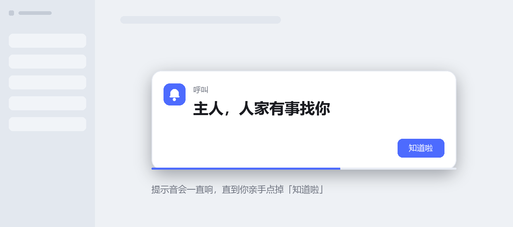

# 呼叫主人 · dsh-caller

[](LICENSE)
[](https://github.com/ChuxueTeam/dshOwnerCaller)
[](tools)

> 需要你本人回到电脑前的时候，让 DSH 弹窗并出声喊你。
> **呼叫会一直响，弹窗也不会自己消失——直到你亲手点掉它。**



---

## 这是什么

一个 [DeepSeek Harness](https://github.com/deepseek-ai) 插件。模型需要你确认、需要你做决定、或者任务已经做完时，可以调用工具 `call_owner` 把你叫回来；你也可以在设置面板里随时自己试一次。

它是**强打扰**的，而且这一点是刻意设计的：

- 提示音**循环播放**；默认用系统语音把弹窗文案念出来，也可以用内置音效或你自己的音频文件。
- 弹窗**不会自动消失**，必须你亲手关掉。
- 点「知道啦」、按 `Esc`、或者被更新的一次呼叫挤掉——**任何一条关闭路径都会立刻掐掉声音**。

一声铃没听见，就等于没叫到人。所以这个插件宁可吵一点，也不做「3 秒后自动消失」那种提醒。

## 特性

| | |
| --- | --- |
| 🔔 **可自定义弹窗** | 标题、正文、一行小字说明都能改，默认文案「主人，人家有事找你」 |
| 🔊 **三种提示音来源** | 系统语音朗读当前文案（默认）/ 内置音效 / 本地音频文件 |
| ♾️ **一直响到手动关闭** | 循环播放，只有你关掉弹窗才停 |
| 🚨 **紧急模式** | 换用 🚨 与更醒目的样式，让模型能表达「这次真的急」 |
| 🔕 **可以闭嘴** | 设置里关掉「允许 AI 呼叫我」，模型再调工具也叫不动你 |
| 💬 **工具回执** | 没有打开的窗口、或你已关掉开关时，工具如实返回 `delivered: false`，模型不会以为已经叫到你了 |
| 🪟 **系统通知**（可选） | 窗口不在最前面时，再用 Windows 通知提醒一次 |
| 🔌 **零侵入** | 不改任何内置包文件、不读业务 DOM、不发起任何外部网络请求 |

## 安装

插件是**单包双面**：`lib/index.js` 是宿主半边（HTTP 路由 + 模型工具），`lib/client.js` 是浏览器半边（设置面板 + 弹窗 + 提示音）。

### 方式一：从 GitHub 装

```powershell
dsh plugin --profile desktop add github:ChuxueTeam/dshOwnerCaller
```

### 方式二：本地开发

```powershell
git clone https://github.com/ChuxueTeam/dshOwnerCaller.git
dsh plugin --profile desktop add link:<你的路径>/dshOwnerCaller
```

### 装完之后

| 改了什么 | 怎么生效 |
| --- | --- |
| 客户端半边 `lib/client.js` | **重新加载页面**（`Ctrl+R`）。新增的客户端插件要等下一次页面加载才会进入 `window.__DSH_BOOT__` |
| 宿主半边 `lib/index.js` | **重启一次 DSH**。宿主模块有模块缓存，禁用再启用插件也会拿回旧模块 |

只改设置（文案、音频、音量）不用做任何事，存 `localStorage`，即时生效。

## 使用

1. 打开 **设置 → 呼叫主人**，按你的口味调好文案和提示音。
2. 点 **「立即呼叫（测试）」** 试一次完整效果；**「只预览弹窗」** 只看样式不出声；**「试听提示音（只响一遍）」** 单独试音频（试听不循环，免得在设置页里一直响）。
3. 之后模型在需要你的时候会自己调用 `call_owner`。

### 工具 `call_owner`

| 参数 | 类型 | 说明 |
| --- | --- | --- |
| `text` | `string` | 本次弹窗文案（最多 300 字）；省略则用设置里的默认文案 |
| `reason` | `string` | 可选，一行小字说明为什么叫你 |
| `urgent` | `boolean` | 紧急：换 🚨 与更醒目的样式 |
| `silent` | `boolean` | 只弹窗、不响 |

返回 `{ delivered, clients, text?, note }`。`delivered` 为 `false` 时，说明当前没有打开的 DSH 窗口，或你在设置里关掉了「允许 AI 呼叫我」——模型会据此改用普通文字回复，而不是傻等。

## 设置项

全部在 **设置 → 呼叫主人**，分三组：

| 分组 | 设置 |
| --- | --- |
| **呼叫方式** | 允许 AI 呼叫我 · 弹窗小标题 · 弹窗文案 · 弹窗停留（`0` = 必须手动关闭） |
| **提示音** | 播放提示音 · 一直响直到我关掉弹窗 · 音频来源 · 语音音色与语速 · 音频文件 · 音量 |
| **提醒方式** | 同时发送系统通知 · 立即呼叫（测试） · 只预览弹窗 |

内置音效有四种：清脆门铃、柔和木琴、急促三连，以及一段女声「主人，人家有事找你」。

## 工作原理

```
        ┌──────── 宿主进程 ────────┐            ┌──── 浏览器 ────┐
模型 ──▶ call_owner 工具 ──┐        │            │                │
                          ├─▶ 事件总线 ──▶ SSE ──┼─▶ 弹窗 + 提示音 │
设置面板「立即呼叫」───────┘        │   /stream  │                │
        └──────────────────────────┘            └────────────────┘
```

- 呼叫事件先落进宿主进程里的一条小总线，再通过 `GET /api/dsh-caller/stream`（SSE）实时推给浏览器；SSE 建不起来时自动退化成 1.5 秒轮询 `GET /api/dsh-caller/poll`。
- 浏览器半边常驻一条 SSE 连接，收到 `call` 事件就弹窗并起播放器；**弹窗的关闭回调持有播放器的 `stop()`**，所以关窗即静音，不存在「弹窗关了声音还在响」。
- 用户设置的音源放不出来（文件被删、格式不支持、自动播放被拦）时，会退到内置音效兜底，保证叫得动。

宿主半边注册的全部路由（都挂在 `/api/dsh-caller/`）：`stream` `poll` `assets` `file` `tts` `register` `call` `upload`。

## 目录结构

```
dshOwnerCaller/
├── lib/
│   ├── index.js         # 宿主半边：HTTP 路由 + call_owner 工具
│   └── client.js        # 浏览器半边：设置栏目 + 弹窗 + 提示音 + SSE
├── assets/              # 内置音频（三种音效 + 一段女声）
├── tools/               # 资源生成脚本 + 两套离线验收
├── cordis.patch.yml     # bundle 挂载声明
└── package.json         # dsh.bundle + dsh.client（单包双面）
```

## 常见问题

**Q：装了但设置里没有「呼叫主人」？**
A：客户端半边要等页面重新加载才挂载，按 `Ctrl+R`。

**Q：改了代码不生效？**
A：见上面的表格——客户端刷新页面，宿主重启 DSH。

**Q：语音没有声音？**
A：系统语音依赖 Windows 的 `System.Speech`（SAPI）。合成失败时插件会自动退回内置音效。第一次朗读要花大约 1 秒生成，之后走磁盘缓存。

**Q：会不会一直响个没完？**
A：会，这正是它的用途。真嫌吵就把「弹窗停留」改成 N 秒，或者关掉「一直响，直到我关掉弹窗」。

## 开发与测试

两半边各有一套离线验收，不依赖 DSH 运行时：

```powershell
npm install           # 只装测试依赖：domino + react + react-dom
npm test              # 两套一起跑，共 89 项断言
npm run test:host     # 宿主半边 19 项：路由、SSE、Range、上传、SAPI、工具定义
npm run test:client   # 浏览器半边 70 项：domino + 真 React 无头渲染，含弹窗与循环提示音
```

客户端验收需要一组**同源同版本**的 React；脚本会自己从本仓库 `node_modules`、DSH 自带依赖里找，找不到就明确打印「跳过」而不是假装通过。

浏览器半边的测试值得说一句：它用一个真 DOM（domino）+ 真 React（`react-dom/server`）把设置面板渲染出来，再模拟 SSE 事件驱动弹窗，验证「循环播放」「关窗即停音」「兜底音效」这些不看截图就很容易写错的行为。

资源重新生成（可选，仓库里已带成品）：

```powershell
powershell -NoProfile -ExecutionPolicy Bypass -File tools/make_voice.ps1   # SAPI 原始语音
python tools/make_chimes.py                                                # 音效 + 补尾部静音
```

音频末尾都留了一小段静音，循环播放时才有呼吸感。

## License

[MIT](LICENSE) © 2026 ChuxueTeam

---

### English TL;DR

`dsh-caller` is an attention-getting plugin for DeepSeek Harness. When the agent needs you back at the keyboard it calls the `call_owner` tool, which pops a card on screen and plays a sound **on a loop until you dismiss it** — the popup never auto-closes, by design. The sound can be Windows SAPI speech reading your own text, one of the bundled chimes, or any local audio file. Everything is configured under **Settings → 呼叫主人**, and the plugin makes no external network requests.
